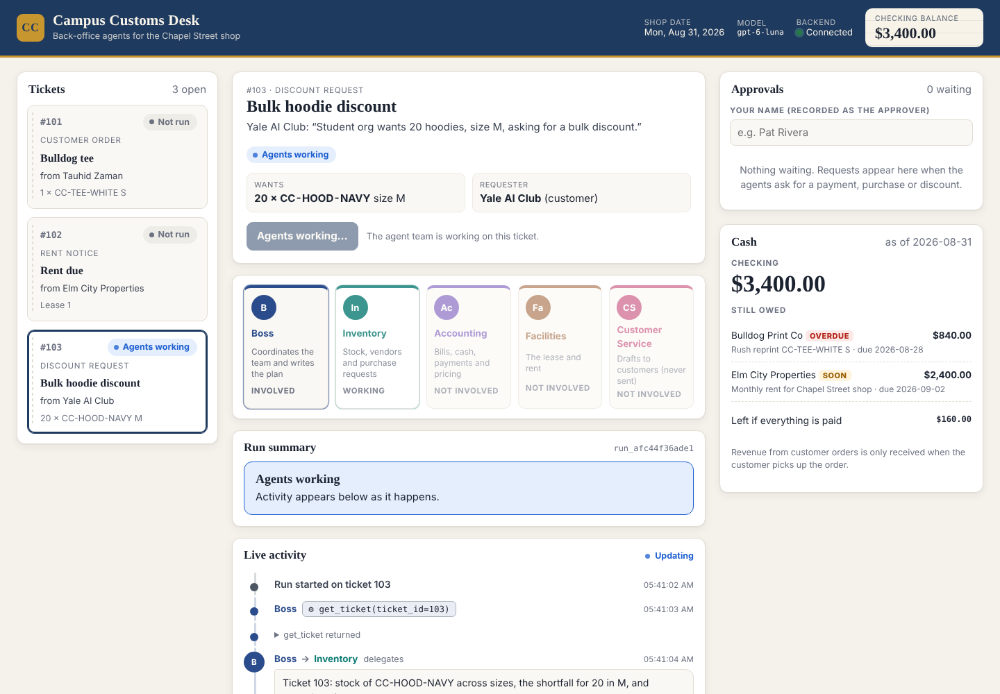
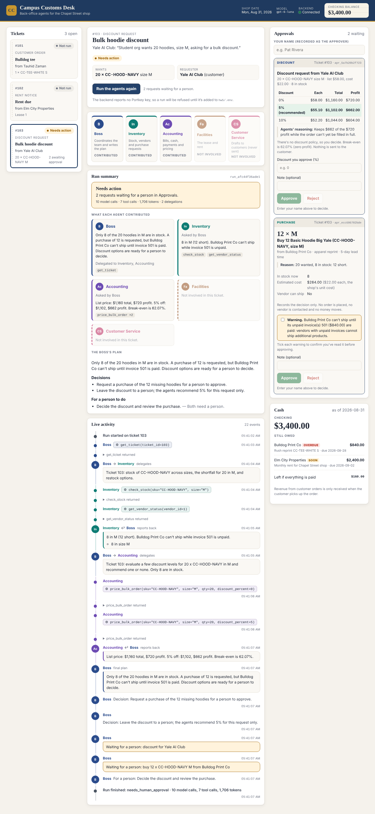
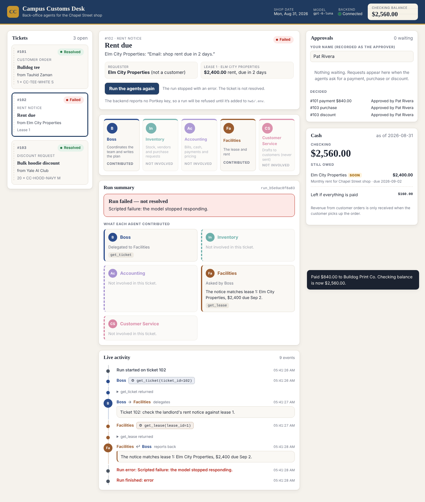
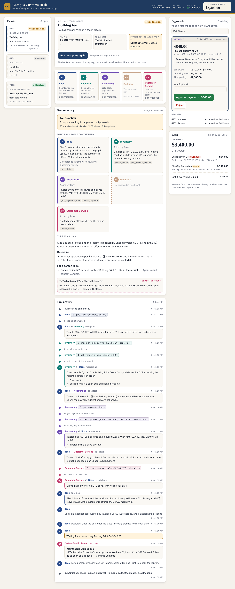
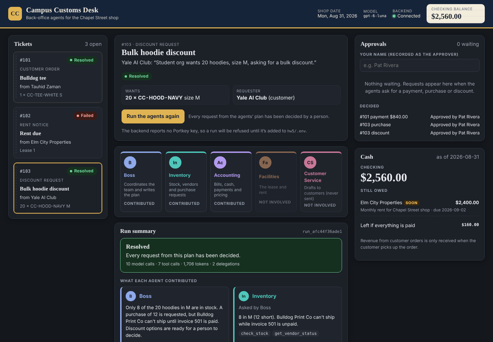
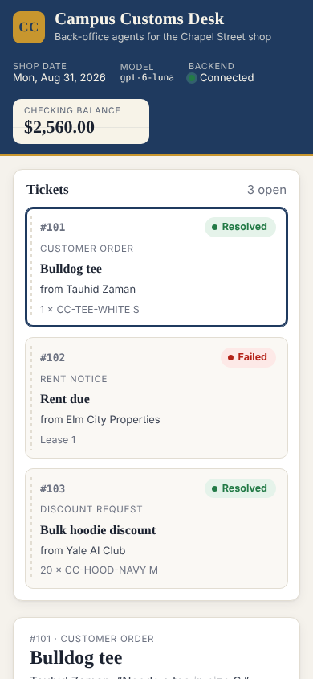

# Campus Customs Desk — Dashboard Design

The dashboard (`hw5/frontend`) is where a person watches the five Campus Customs agents work a ticket, sees what each one contributed, and approves or rejects what they ask for. It's built with React, Vite and TypeScript. It talks only to the FastAPI backend at `http://localhost:8000`, and through it to the MCP server and the working database.

```bash
cd hw5/frontend
npm install
npm run dev        # http://localhost:5173 (the backend must be running on port 8000)
```

The screenshots in `output/design_screenshots/` come from the dashboard's end-to-end test (`npm run e2e`). That test runs the real backend and MCP server on a temporary copy of the database, with **scripted agents in place of gpt-6-luna**. The activity shown is scripted test data, not a real AI run, and the payment shown went into the temporary copy, not the working database.

## The idea: a back-office desk

The shop's back office is a desk with paper tickets on it, a ledger of cash, and five colleagues passing work between them. The design leans into that, instead of looking like a generic admin panel:

- **Tickets are paper stubs**, with a perforated edge down the left side, stacked in the order they came in.
- **Cash is a ledger card**: a cream card with faint ruled lines, set into the navy header, with the balance in a serif face like an entry in a book.
- **Each agent has its own colored lane**: a color, an avatar and a vertical lane that runs through the conversation. You can follow one agent down the timeline, or watch work hop from lane to lane as it's handed over.

Type is chosen to match: headings and money in a book serif (Iowan Old Style, Palatino or Georgia, whichever the computer has), body text in the system sans-serif, and tool calls in monospace, so "what the agents said" and "what they ran" never look alike.

## Layout



The page has a header and three columns, read from left to right: **pick a ticket → watch the agents → decide**.

| Area | What's in it |
|---|---|
| **Header** (navy, gold rule) | The shop's name, the shop date (`desk.date_today`, Mon, Aug 31, 2026), the model (`gpt-6-luna`), whether the backend is connected, and the **checking balance** ledger card |
| **Left: Tickets** | The three ticket stubs: number, type, subject, requester, item and a status pill. The selected stub is outlined. |
| **Centre: the ticket workspace** | <ol><li>**Ticket header:** the request in the requester's words, key facts (item wanted, whether the requester is a customer, the linked invoice or lease with what's still owed and when), the status, and the **Run the agents** button</li><li>**Team strip:** the five agents</li><li>**Run summary:** the outcome, what each agent contributed and the Boss's plan</li><li>**Live activity:** the timeline</li></ol> |
| **Right: Approvals and Cash** | <ul><li>**Approvals:** the approver's name, one card per waiting request (requests for the selected ticket first), and the recent decisions</li><li>**Cash:** the checking balance, what's still owed, and what would be left if everything were paid</li></ul> |

On narrower screens the right column moves below the workspace (two side-by-side panels). On a phone everything stacks into one column with no sideways scrolling, and the header wraps so the balance stays visible.

## How the agents are displayed

| Agent | Color | Mark | Role shown |
|---|---|---|---|
| Boss | Navy blue | B | Coordinates the team and writes the plan |
| Inventory | Teal | In | Stock, vendors and purchase requests |
| Accounting | Violet | Ac | Bills, cash, payments and pricing |
| Facilities | Copper | Fa | The lease and rent |
| Customer Service | Raspberry | CS | Drafts to customers (never sent) |

The colors were picked to be clearly different from each other *and* from the status colors (green, amber, red, blue), so an agent is never mistaken for a status. Each has a lighter version for dark mode.

**Team strip.** One card per agent, with its color along the top edge. Each card shows a state:

| State | When |
|---|---|
| Standing by | Before a run |
| Working | The agent is acting right now: its card is ringed in its color and its avatar gently pulses |
| Involved / Contributed | The agent took part in the run |
| Not involved | The agent wasn't needed: its card is faded |

You can see at a glance that, for example, Facilities sits out the hoodie order. This matches the Problem 6 plan of not having everyone work on every ticket.

**Live activity timeline.** Every event appears in its agent's lane, as it happens (the dashboard checks for new activity every second during a run):

| What happened | How it looks |
|---|---|
| One agent asks another | **Boss → Inventory** in both agents' colors, with the task in a speech bubble |
| An agent reports back | **Inventory ↩ Boss**, with the summary and findings in a bubble marked by the agent's color |
| An MCP tool call | A small monospace chip in the agent's color, for example `⚙ check_stock(sku="CC-HOOD-NAVY", size="M")`, with a collapsible "returned" line showing the tool's full result |
| An answer sent back by a rule check | Amber, listing the problems the code found |
| A customer draft | Shown in Customer Service's lane, marked **not sent** |
| A request for a person | Amber: "Waiting for a person: buy 12 × CC-HOOD-NAVY M from Bulldog Print Co" |
| Run start, finish and errors | Small system lines, with the model calls, tool calls and tokens used |

**What each agent contributed.** When a run ends, the summary shows one card per agent. Each card has who asked it, its own summary of what it found, who it delegated to, which MCP tools it used (with counts), and any answers sent back or tool errors. Agents that weren't involved get a dashed, faded card saying so. Below the cards is the Boss's plan: its decisions, what a person needs to do, and any customer drafts, clearly labeled **Draft · not sent**.



## How resolved, unresolved and failed tickets appear

Every ticket has one status pill, used on its stub and in its header, worked out from its latest run and that run's approval requests:

| Pill | Color | When |
|---|---|---|
| **Not run** | Grey | The agents haven't worked on it |
| **Agents working** | Blue, pulsing dot | A run is in progress |
| **Needs action** | Amber | The run finished, but a request is waiting for a person. Also used when its requests expired in a database reset. |
| **Resolved** | Green | The run finished and nothing is left for a person: either the plan needed no approval, or every request from that run was decided |
| **Failed** / **Stopped** | Red | The run errored, or hit an AI usage limit |

**Failed runs are never marked resolved.** A run that ends in an error or a usage limit is always red. Its summary banner says **"Run failed — not resolved"** with the reason. Any status the dashboard doesn't recognise is also treated as not resolved, rather than guessed at. This logic is in `frontend/src/status.ts` and covered by unit tests.



The run summary opens with a banner in the same colors:
- green **Resolved**
- amber **Needs action** ("2 requests waiting for a person in Approvals")
- red **Run failed — not resolved**
- blue **Agents working**

Under the banner is a line with the run's usage (model calls, tool calls, tokens, delegations). "Resolved" here means the agents' work and every decision on it are done. The ticket's own record in the database stays open, because nothing in the system closes tickets.

## Approvals: seeing everything before approving

Each request is a card with a colored label: **Payment** (Accounting's violet), **Purchase** (Inventory's teal) or **Discount**. The card puts what you're agreeing to first:

- **Payment:**
  - the amount in large type, who's paid, and the invoice or rent with its due date ("3 days overdue")
  - the agents' **reason**
  - a live check from the backend: what's still owed, the checking balance now, and the balance after paying
  - anything that breaks the shop's rules, shown in red, which disables Approve
- **Purchase:**
  - the quantity and item ("12 × M — Buy 12 Basic Hoodie Big Yale"), the vendor, its specialty and lead time
  - the **reason**
  - stock on hand, the estimated cost (with how it was estimated), and whether the vendor can ship
  - a plain note that approving only records the decision: no order is placed, no vendor is contacted, no money moves
- **Discount:** the facts, a small table of the discount levels the agents evaluated (the recommended row highlighted), their reasoning, and a box where the person types the discount they choose

**Warnings** (an unpaid vendor invoice, a bill already paid, more than is owed, another request for the same bill) appear in amber boxes, each with its own checkbox. **Approve stays disabled until every warning is ticked and the approver's name is filled in.** The confirmed warnings are sent to the backend, which re-checks them before anything is recorded. The approver's name is remembered in the browser between visits. After a decision, a short message confirms what happened (for example *"Paid $840.00 to Bulldog Print Co. Checking balance is now $2,560.00."*), and the card moves to **Decided** with who decided it.



## How cash appears

Cash is shown in two places, both from `GET /api/cash` (the MCP server's `get_payments_due`):

- **The ledger card in the header** is always visible. When the balance changes after a payment, the card is outlined in gold for a few seconds and shows the change (for example −$840.00).
- **The Cash panel** has the checking balance in large serif figures and the as-of date. Below it, a ledger of what's still owed: payee, description, due date and amount. **Overdue** bills get a red tag, and those due within a week get an amber **Soon** tag. Then comes what would be left if everything were paid, and a reminder that order revenue isn't counted until the customer picks up.

Both refresh right after a payment is approved, after each run, and every 10 seconds in the background.

## Dark mode and accessibility



- **Dark mode:** the dashboard follows the computer's light or dark setting. Every color, including the five agent colors and the status colors, has a dark-mode version.
- **Color is never the only signal:**
  - status pills have words
  - agents have names and marks
  - warnings say "Warning"
  - drafts say "not sent"
- **Screen readers and keyboard:** the timeline and balance are announced to screen readers as they change, and buttons and checkboxes have clear labels and visible focus outlines.
- **Motion:** the pulsing animations stop when the computer asks for reduced motion.



## What makes it distinctive

- **The desk metaphor:** paper ticket stubs, a ruled ledger card for cash, and a book serif for money and headings give it the feel of a real shop's back office, not a stock admin template.
- **Agents as lanes:** each agent's color runs through the timeline as a lane, so handoffs ("Boss → Inventory") are visible as a change of color, not just a line of text. The team strip shows at a glance who's working, who contributed and who sat a ticket out.
- **Words and actions look different:** messages between agents are speech bubbles, while MCP tool calls are monospace chips with their results one click away.
- **Honest status:** "Resolved" only when the work and every decision on it are done. Failures are always red and say "not resolved".
- **Safety you can see:** the amount, reason, live cash check and every warning are on the card, and Approve only unlocks once each warning has been ticked.

## Testing

| Test | Command | What it checks |
|---|---|---|
| Unit tests | `npm test` | 9 tests of the status and summary logic, including that failed and stopped runs are never "Resolved" |
| Type check and build | `npm run build` | TypeScript in strict mode, and a production build |
| End-to-end | `npm run e2e` | 32 checks in Chromium against the real backend and MCP server on temporary data, with scripted agents (no AI calls, no real money). See below. |

The end-to-end test:
- **Ticket 103:** runs the agents and watches it live, then approves the purchase (only after ticking the vendor warning) and the discount.
- **Ticket 101:** runs the agents and approves the payment, checking that the balance in both places updates to $2,560.00.
- **Ticket 102:** runs the agents with a scripted failure and checks it shows as **Failed**, not resolved.
- **Layout:** checks phone width and dark mode.
- **Errors:** checks there are no browser console errors.

The dashboard was also opened against the real backend (`uvicorn main:app --reload --port 8000`) and the working database. It showed the three tickets and the $3,400.00 balance. Clicking Run showed the backend's "PORTKEY_API_KEY is not set" message, without starting a run or changing anything.
